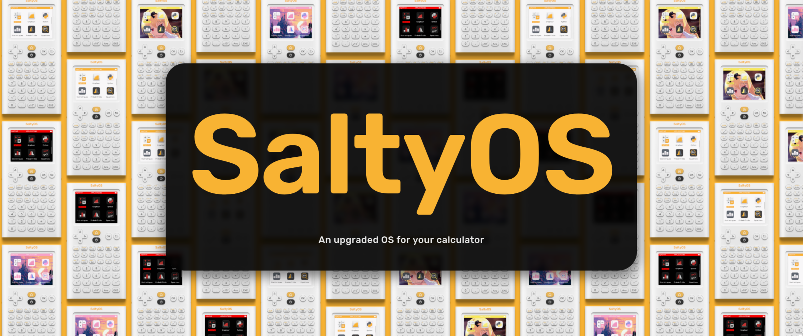

  
  
   
  
  

## About

It's an app that easily installs and starts [Salty-OS](https://github.com/SaltyMold/Salty-OS) on your numworks calculator.

## Installation

To install this app, you'll need to:
1. Download the **`Salty-OS-Launcher-Salty-OS-{version}-{model}.nwa.nwa` file**, which you can download from the [Releases](https://github.com/SaltyMold/Salty-OS-Launcher/releases/).
2. Connect your **NumWorks calculator** to your computer using a USB cable.
3. Head to **[my.numworks.com/apps](https://my.numworks.com/apps)** to send the **`nwa` file** on your calculator along the **`mjpeg` video**.

## How to use

| Key   | Action        |
|-------|---------------|
| OK  | Continue      |
| Back  | Quit      |

## Documentation

The app writes on the flash using SVC calls. See https://nwagyu.org/reference/apps/syscalls.html.

The app follows these steps:
1. It checks if the userland in the app's data is there.
2. It checks if the calculator model is the same as the userland model in the app's data.
3. It checks if the calculator is in slot A.
4. It erases the slot B flash.
5. It writes the userland in the slot B flash.
6. It erases the userland in the app's data.
7. It writes a sample of themes in the theme area of Salty-OS.
8. It jumps to the userland in the slot B flash.

See more at: https://nwagyu.org/reference/firmware/slots.html

## Build the app

I made tutorials here :
- [C-App-Guide-for-Numworks](https://github.com/SaltyMold/C-App-Guide-for-Numworks)